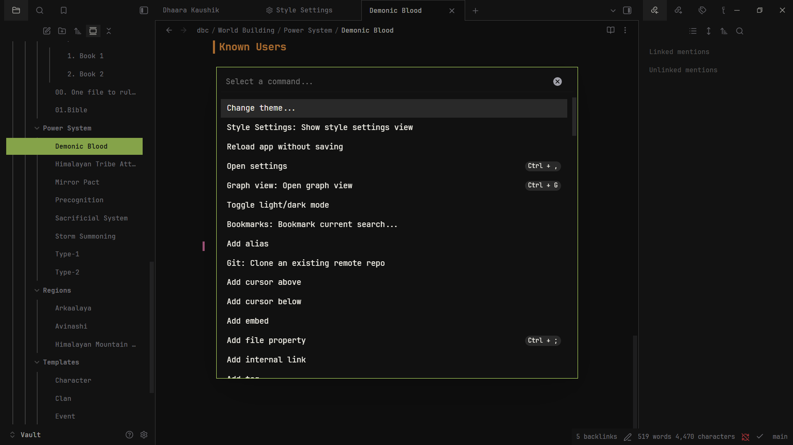

# Omarchy X NeoBrutal

A dark and light neobrutalist theme for [Obsidian](https://obsidian.md), inspired by the Omarchy desktop look: hard square edges, monospace type, flat surfaces and high-contrast lime, pink and orange accents.

<!-- Add a screenshot here, e.g.  -->

## Features

- Dark and light palettes, both fully customizable
- Square, flat interface (optional corner radius slider)
- Monospace typography throughout (JetBrainsMono Nerd Font by default)
- Heading side-bars, colour-coded headings, active-line indicator in the editor
- Connected tab and note pane: the open tab is outlined on its outer edges and merges into the page
- Sidebar file tree with indentation guides, coloured vault dot and a solid active-file highlight
- Styled command palette and quick switcher
- Mobile support: square, optionally full-width bottom navigation bar and larger touch targets
- Configurable through the [Style Settings](https://github.com/obsidian-community/obsidian-style-settings) plugin

## Requirements

- Obsidian 1.4.0 or newer
- [Style Settings](https://github.com/obsidian-community/obsidian-style-settings) plugin (optional, but needed for the options below)
- [JetBrainsMono Nerd Font](https://www.nerdfonts.com/font-downloads) installed on your device (optional; you can change the font in Style Settings)

## Installation

### Manual

1. Download or clone this repository.
2. Copy the folder to `<your vault>/.obsidian/themes/Omarchy X NeoBrutal/`.
   It must contain `manifest.json` and `theme.css`.
3. In Obsidian, go to **Settings → Appearance → Themes** and select **Omarchy X NeoBrutal**.

### Community themes

Once this theme is accepted into the community list, you can install it from **Settings → Appearance → Themes → Manage**.

## Customization

Open **Settings → Style Settings → Omarchy X NeoBrutal**.

| Section | What you can change |
| --- | --- |
| Typography | Font family, inline title size, heading 1–4 sizes, content spacing, line height |
| Layout | Interface corner radius |
| Mobile interface | Navigation bar height and icon size, full-width bar toggle, touch target size |
| Sidebar | Row vertical and horizontal padding |
| Command palette | Input padding, result vertical and horizontal padding |
| Interface details | Hide or show folder dots, collapse icons, active-line indicator, heading side-bars; heading bar width; tag radius |
| Reading comfort | List indentation, modal outline colour |
| Colors | Every background, border, text, accent, heading, tag, quote and active-sidebar colour, with separate dark and light values |

## Default palette

| | Dark | Light |
| --- | --- | --- |
| Editor background | `#111111` | `#F5F3EE` |
| Sidebar background | `#171717` | `#EAE8E1` |
| Main text | `#F2F0E8` | `#242424` |
| Accent / H1 / links | `#C6F36A` | `#668B27` |
| Interactive accent / tags | `#F37DB7` | `#D94D91` |
| Headings 2–6 | `#FF9F43` | `#C46A20` |
| Border | `#555555` | `#B8B4AA` |

## Tweaking the CSS directly

A few values live in `theme.css` rather than in Style Settings:

- **Sidebar indent per level:** `--nav-item-children-padding-start` in the `body` block.
- **Tab outlines:** `--tab-outline-width` is set to `0px` on purpose. The theme draws its own tab outline in section 4.
- **Folder dot colours:** section 7.

## Troubleshooting

- **A setting has no effect:** disable your CSS snippets and other themes-related plugins, then reload. Snippets load after the theme and can override it.
- **A value looks stuck:** use the reset button next to that setting in Style Settings.
- **Font looks wrong:** the font must be installed on the device you are using. Mobile devices need it installed separately.
- **Something looks off after an Obsidian update:** open an issue with a screenshot and your Obsidian version.

## Contributing

Issues and pull requests are welcome. Please include a screenshot for any visual change, and say whether it affects dark mode, light mode or both.

## License

MIT. See [LICENSE](LICENSE).
